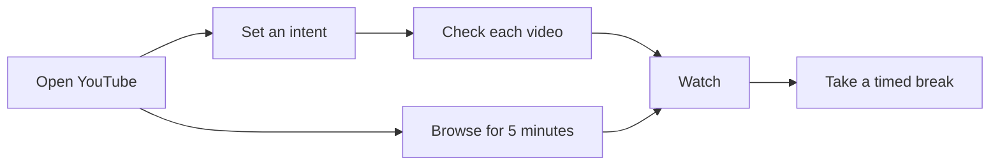

# Curb Your YouTube

Choose what to watch, hide distractions, and take timed breaks. A desktop extension for Chrome and Firefox.



Hide Shorts, recommendations, comments, and thumbnails from the toolbar or Settings. Add a Gemini API key in Settings to summarize public videos.

## Install locally

Run `npm run build` with Node.js 20 or later.

- **Chrome 120+** — Open `chrome://extensions`, turn on **Developer mode**, and **Load unpacked** from `dist/chrome`.
- **Firefox 140+** — Open `about:debugging#/runtime/this-firefox` and **Load Temporary Add-on** from `dist/firefox/manifest.json`.

After rebuilding, reload the extension and any open YouTube tabs.

## Develop

```sh
npm test
npm run check
npm run package
```

Browser tests use Playwright for Chromium and WebDriver BiDi for Firefox. See [test setup](VALIDATION.md) and [Chrome Web Store submission](STORE_SUBMISSION.md).

[Project site](https://sreekargpalli.github.io/CurbYourYoutube/) · [User guide](GUIDE.md) · [Privacy policy](https://sreekargpalli.github.io/CurbYourYoutube/privacy.html) · [MIT license](LICENSE)
